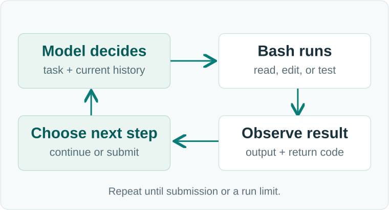
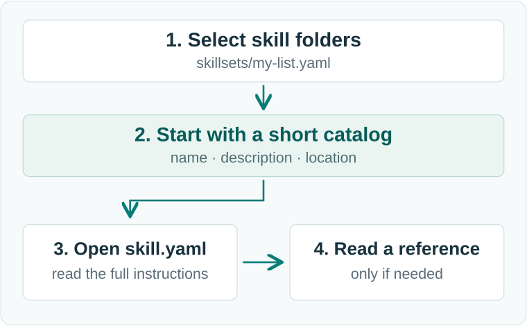
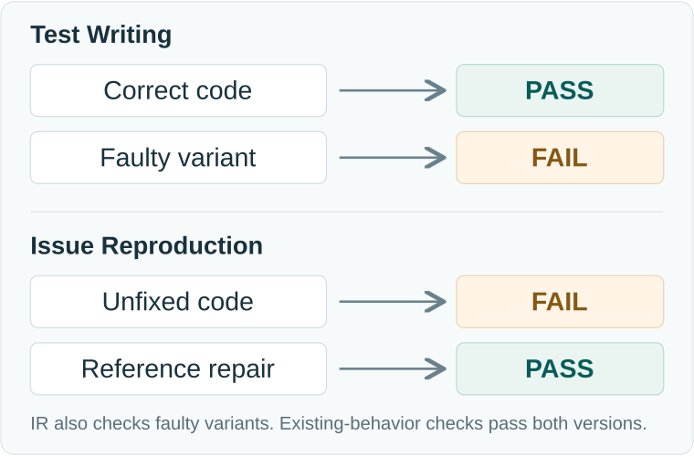

<div class="eyebrow">CS408 · Software Testing · Lab 2</div>

# Teach a coding agent to write better tests

<div class="lead">Turn testing methods from class into reusable skills. Let a small coding agent use them. Then check the tests it actually produces.</div>

<div class="facts"><span><b>3</b> project parts</span><span><b>6</b> public benchmark tasks</span><span><b>2 h</b> agent time setting per run</span></div>

## What you will build

Your main artifact is a set of **skills**. Each skill is a small folder. It contains
instructions in YAML and may contain supporting files. You also write a YAML list
that selects which skills to use in one run.

The supplied agent reads a task, works with its repository, and writes tests. You
compare two conditions:

- **Vanilla:** run the agent with skills disabled.
- **Skills:** run the same agent with your selected skill list.

Keep the model, task, source, and budgets the same. Read the generated tests and
execution records. Explain which behaviors your skills helped test and which
mistakes remain.

The project has three parts:

| Part | Starting point | Agent's work |
| --- | --- | --- |
| Warmup | A small, correct Garage program and its specification | Learn the workflow and write your first skills. |
| Test Writing | A correct implementation in a larger repository | Add tests that check its behavior. |
| Issue Reproduction | An unfixed repository and an issue description | Write tests that expose the issue and pass after a correct repair. |

By the end, you should be able to turn a testing method into clear instructions,
choose useful test inputs, justify expected results, and evaluate a generated test
suite beyond its number of tests.

## How a coding agent works

A **language model** produces text or a request to call a tool. A **coding agent**
adds a loop around that model. The loop lets the model inspect files, run commands,
observe results, and choose another action.

### ReAct: reason, act, and observe

**ReAct** combines reasoning with actions. A step may start with a short plan. The
agent then chooses a tool call. The tool runs, and its output becomes an
observation for the next step. The agent can revise its plan after seeing a test
failure or an unfamiliar API.



*A plan is useful only if it leads to useful actions. Inspect the commands, files,
and test results in the saved trajectory.*

For example, the agent may read an API, write a small test, run that test, and
inspect its failure. A failure may come from the program, a wrong expected value,
or a mistake in the test setup. The next action should help tell these cases apart.

ReAct was introduced by [Yao et al.](https://arxiv.org/abs/2210.03629). In this lab,
we use the pattern to understand the agent's workflow. Your report should focus on
observable actions and test results.

## The lab's small agent

We use the official **mini-swe-agent**, pinned to a specific Git commit. Its
`DefaultAgent` runs the model/tool loop. It is small enough to inspect. The
supplied agent uses one `bash` tool to read files, edit tests, and run commands.

The course adapter adds three things:

1. A connection to the Purdue RCAC model API, with input/output token records.
2. A udocker environment for the larger repository tasks.
3. A loader for the skills selected for a run.

Garage runs in a local Python environment. The six larger tasks run in supplied
Linux ARM64 images. The images already contain their source and dependencies.
There is no need for the agent to install packages inside a task.

The same model and official agent are used for vanilla and skills. Changing the
agent implementation would change the experiment. Keep your work in your own
skill folders and skill-list files.

## Skills and selected lists

A skill has three required fields:

```yaml
name: my-skill
# A short description of WHEN this skill is useful.
description: Explain when the agent should use this skill.
# The full instructions. Use a YAML multiline string.
instructions: |
  Write your own instructions here.
  If a supporting file is needed, name its path relative to this skill folder.
```

The provided `skills/example/` demonstrates the format. It contains no testing
strategy or Garage reference solution. Replace the example with your own work.
Skill names must be unique in the selected list.

### Select a different list for each comparison

```text
skills/
  my-skill/skill.yaml
  another-skill/skill.yaml
skillsets/
  first.yaml
  combined.yaml
```

For example, `skillsets/combined.yaml` can select two directories:

```yaml
skills:
  enabled:
    - ../skills/my-skill
    - ../skills/another-skill
```

Paths in that list are relative to the list file. Creating a folder under
`skills/` does not enable it. Omitting `--skills-config` turns skills off entirely;
vanilla does not use an empty skill-list file.

### Read detail only when it is needed

At the start of a skills run, the prompt contains a catalog: each selected skill's
name, description, and file location. It does not contain every skill body. The
agent can use bash to read the full `skill.yaml` when it needs that skill. It can
then read a supporting file if the instructions call for it.



A selected skill is available to the agent. That does not guarantee that the agent
reads or follows it. Check the trajectory. Distinguish “selected,” “read,” and
“used correctly” in your report.

## Set up and run

Use a Linux ARM64 machine for all tasks. Linux x86_64 can run Garage, but the
current benchmark images are ARM64. The setup script reports the architecture.
It does not emulate another CPU.

From `labs/lab2/skeleton/`:

```bash
bash setup.sh --check
bash setup.sh
source scripts/activate.sh
bash setup.sh --check
```

Setup installs tools in project-owned directories. It does not use sudo or apt.
The Python environments and tools are separated by architecture. The project
`gh` launcher chooses the matching binary each time it runs. It leaves existing
system and shared-home GitHub CLI installations intact.

You need a Purdue RCAC API key to run the agent:

```bash
export PURDUE_RCAC_API_KEY='YOUR_KEY'
```

Use your own key. Keep it out of Git and skill files. Public source and container
images do not require a GitHub login. Setup reports login status but does not
start an interactive login.

Each run uses temperature 0, at most 60 model calls, and a two-hour agent time
setting. The runner sets no output-token cap. A model call can take time, and the
agent checks its time budget between calls. A live call can therefore finish
after the nominal limit. A server-side gateway error is recorded as a failed
request, not as zero token use.

## Part 1 — Warmup

The Garage task is a small Python program. You receive a correct implementation,
a specification, and one starter test. The specification describes vehicle
names, capacity, visits, re-entry, charges, and history. Read it before choosing
inputs or writing expected results.

```bash
python -m lab2 warmup/garage --output outputs/garage-vanilla
python -m lab2 warmup/garage --skills-config skillsets/my-list.yaml \
  --output outputs/garage-skills
```

Write your own skill first and create `my-list.yaml` before the second command.
Use a new output directory for every run. Compare the generated tests and the
trajectory. Look for unsupported expected values, missing assertions, and behavior
that is exercised without being checked.

You may edit the Garage starter test and add test files. Preserve `garage.py`
and `SPEC.md`. The runner saves a separate working copy, so each attempt starts
from the supplied program.

**Warmup feedback:** the existing TA checker first requires the suite to pass on
the correct implementation with source unchanged. It then tests 21 faulty
versions. A valid suite's practice score is `100 × detected versions / 21`.
Warmup is reported separately from the six-task benchmark mean. No Garage
reference skills or TA fault implementations are included in the skeleton.

## Part 2 — Test Writing

A Test Writing task gives the agent a **correct implementation** and a testing
objective. The agent adds tests. Expected answers should follow the specification
and visible repository behavior. The tests should reject relevant faulty
implementations.

- **Maddy:** test mail routing by sender. Check domain rules, rejection, address
  normalization, and rule precedence.
- **MinIO:** test ETag parsing and comparison. Check multipart aggregation,
  encrypted tags, and the form returned to S3 clients.
- **k6:** test execution segments. Check input sequences, boundaries, striped
  allocation, and integer execution tuples.

```bash
python -m lab2 test-writing/minio --output outputs/minio-vanilla
python -m lab2 test-writing/minio --skills-config skillsets/my-list.yaml \
  --output outputs/minio-skills
```

A TW test must pass on the supplied correct implementation. There is no
fail-before-repair condition for this task type.

## Part 3 — Issue Reproduction

An Issue Reproduction task gives the agent **unfixed code** and a description of
the desired behavior. The agent writes tests, not a repair. The TA checks those
tests on the supplied code and on the correctly repaired code.

- **Ansible:** reproduce path traversal when extracting collection archives.
  Check that malicious paths are rejected while legitimate extraction still works.
- **psd-tools:** reproduce the missing typed Blend If API and its use in stored
  values, saved layers, and composited pixels.
- **abs:** reproduce stepped reads and assignments on arrays and strings. Check
  omitted bounds, Unicode behavior, and errors.

```bash
python -m lab2 issue-reproduction/ansible --output outputs/ansible-vanilla
python -m lab2 issue-reproduction/ansible --skills-config skillsets/my-list.yaml \
  --output outputs/ansible-skills
```

A new bug check should fail on the unfixed version and pass on the reference
repair. Checks of existing correct behavior should pass on both. Their role is
set before scoring. A new bug check is not reclassified after seeing it pass the
unfixed code.



For a newly introduced Python API, import it inside a test function. A named test
can then record the missing behavior. A whole test module that cannot be collected
does not show that its behavioral assertions ran.

## How scoring works

Each benchmark task receives one score from 0 to 100. Each task has **checkpoints**.
A checkpoint concerns one behavior, such as rejecting an invalid path. Checkpoints
have equal weight within a task. If there are `N` checkpoints, each is worth
`100/N` points.

The TA has deliberately faulty versions for each checkpoint. Reference tests
first confirm that those versions really violate the intended behavior. Your
checks earn detection credit when they expose those faults.

| Factor | Plain-language meaning |
| --- | --- |
| `V` | How many of this checkpoint's submitted independent checks have a correct expected answer and pass on the correct implementation? |
| `E` | IR only: how many of those correct checks show the required fail-to-pass change, or preserve a preclassified existing behavior? |
| `K` | How many of this checkpoint's faulty versions are detected by eligible correct checks? |

Each factor is a fraction between 0 and 1. The checkpoint scores are:

<div class="formula"><span>Test Writing</span><code>(100 / N) × V × K</code></div>
<div class="formula"><span>Issue Reproduction</span><code>(100 / N) × V × E × K</code></div>

Add the checkpoint points for the task score. A missing checkpoint earns zero.
An incorrect expected answer gives no valid evidence. It cannot earn credit just
because it also fails on a faulty version.

### A small scoring example

Suppose an IR checkpoint is worth 20 points. Three of four checks are correct, so
`V=3/4`. Two of those three meet the required before/after condition, so `E=2/3`.
Those eligible checks expose one of two faulty versions, so `K=1/2`.

The checkpoint earns **5 points**: `20 × 3/4 × 2/3 × 1/2`.
For TW, leave out `E`. A correct TW checkpoint that catches half its faulty
versions earns half of its available points.

<div class="score-lab" aria-labelledby="score-lab-title">
  <div class="score-lab-heading"><div><div class="eyebrow">Try the arithmetic</div><h3 id="score-lab-title">One 20-point checkpoint</h3></div><output id="score-value" aria-live="polite">20.00 / 20</output></div>
  <label class="type-label" for="score-type">Task type <select id="score-type"><option value="IR">Issue Reproduction</option><option value="TW">Test Writing</option></select></label>
  <div class="score-sliders">
    <label for="score-v">V · correct checks <span id="value-v">100%</span><input id="score-v" type="range" min="0" max="100" step="5" value="100"></label>
    <label for="score-e" id="label-e">E · before/after evidence <span id="value-e">100%</span><input id="score-e" type="range" min="0" max="100" step="5" value="100"></label>
    <label for="score-k">K · faulty versions detected <span id="value-k">100%</span><input id="score-k" type="range" min="0" max="100" step="5" value="100"></label>
  </div>
  <p class="score-note">The weights stay fixed. This calculator changes only the three evidence fractions.</p>
</div>

### Correct checks inside a partly wrong test

A long test function may contain several independent checks. Some may be correct
and others wrong. The TA may isolate them for diagnosis. The original input,
setup, and expected result stay unchanged. A correct independent check may earn
credit even when another check in its original function fails on correct code.

The TA does not repair a wrong expected value to improve a submission's score.
An unrelated build error, missing dependency, or timeout is not enough evidence
of a tested behavior. Source or Git-history changes violate the submission rules.

The six-task benchmark uses 80 checkpoints and 90 approved faulty versions. Its
reported mean gives each task equal weight. All six tasks are visible. The
reference fixes and faulty source variants stay with the TA. A score of 100 means
the finite rubric was covered; it does not prove that every possible mistake
would be detected.

## Historical vanilla scores

The following table reports the **lowest previously scored vanilla artifact** for
each task under this same rubric. It excludes skill-assisted outputs, superseded
formulas, candidate-only files, and runs that produced no tests. In particular,
the old abs timeout is not reported as a 0-point test suite.

<!-- baseline:summary -->
| Part | Task | Selected vanilla minimum | Checkpoints |
| --- | --- | ---: | ---: |
| Test Writing | Maddy | 80.00/100 | 5 |
| Test Writing | MinIO | 68.18/100 | 11 |
| Test Writing | k6 | 66.67/100 | 12 |
| Issue Reproduction | Ansible | 40.00/100 | 5 |
| Issue Reproduction | psd-tools | 54.52/100 | 28 |
| Issue Reproduction | abs | 50.88/100 | 19 |

**Mean of these six selected minima: 60.04/100.** These are historical test-quality scores, not a prediction or a matched experiment.
<!-- /baseline:summary -->

These minima come from different historical attempts. Some run settings differ
from the current runner. They are comparison points, not expected scores or a
claim that improvement is statistically reliable. The historical psd-tools run
also violated the Git-history rule; its frozen test-quality score is shown
without a new retroactive penalty. Current submissions must obey the current
runner's rules.

The project README contains each task's full checkpoint table. Exact scores,
selection metadata, and evidence hashes are in `baselines.json`. No TA fixes,
reference skills, generated test bodies, or faulty source patches are published
with those score records.

## What to record and submit

Keep separate output directories for vanilla and skills. The runner refuses to
overwrite a run. It automatically collects changed test files into `submission/`;
the agent does not need to create a manifest.

For each comparison, keep:

1. Your skill folders and the exact selected skill-list YAML.
2. The generated tests under `submission/`.
3. `trajectory.json`, `result.json`, and `usage-summary.json`.
4. A short explanation of a useful change and a remaining failure.

A selected skill may never be read. A test may run code without checking its
result. A test may use a wrong expected answer. Look for those concrete cases in
the saved artifacts. Count behavior checked, not just files or test functions.

Token totals come from the model API. Every request includes its input and output
usage. Input totals include repeated conversation history. Output totals already
include reasoning tokens. Missing usage stops a run and remains missing; it is
never recorded as zero. The local model has no dollar-cost calculation in this lab.

`valid_submission` means that files and protocol checks were accepted. It does
not mean every generated test is correct or that the suite received full marks.
TA scoring is a separate step.

<div class="finish-card"><div class="eyebrow">Before you finish</div><h3>Make the comparison explainable.</h3><p>Keep the settings fixed. Save every attempt you use. Connect each claimed improvement to a test, a behavior, and an execution result.</p></div>

## References and reading

- [ReAct: Synergizing Reasoning and Acting in Language Models](https://arxiv.org/abs/2210.03629) — the agent loop behind the first diagram.
- [Official mini-swe-agent source](https://github.com/SWE-agent/mini-swe-agent) — the lab pins commit `04d809ceab9df28f9adaed044884180159172930`.
- [Purdue RCAC GenAI API](https://docs.rcac.purdue.edu/services/genai/api/) — credentials and request format.
- [uv installer options](https://docs.astral.sh/uv/reference/installer/) — user-owned installation without shell-profile changes.
- [udocker installation](https://github.com/indigo-dc/udocker/blob/master/docs/installation_manual.md) — user-space execution tools.
- [GitHub Pages workflows](https://docs.github.com/en/pages/getting-started-with-github-pages/using-custom-workflows-with-github-pages) — hosting the static HTML edition.

*Reading on GitHub: this Markdown file renders in the normal code browser.
The styled HTML edition is for a local browser or GitHub Pages. GitHub's code
browser displays HTML source; it does not serve a repository HTML file as a website.*
